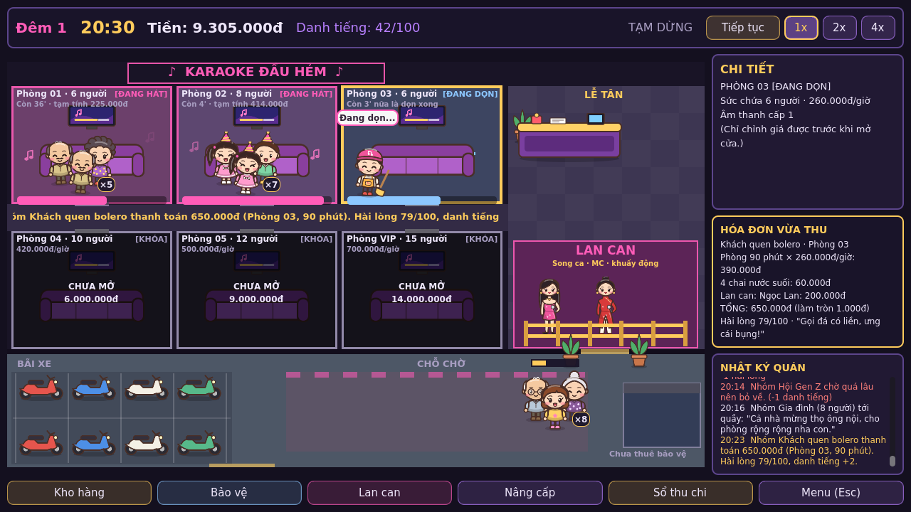

# KARAOKE ĐẦU HẺM

Game quản lý quán karaoke đầu hẻm ở Việt Nam. Chơi đơn, offline, 2D nhìn từ trên xuống, giao diện tiếng Việt.

Trạng thái: **bản dựng sớm, chơi được trọn nhiều đêm**. Xem `docs/TASKS.md`.



## Yêu cầu

- Godot **4.5.1 stable** (bản thường, không cần .NET). Renderer Compatibility, giao diện thiết kế dọc 1024 × 1536 theo đúng mẫu đã duyệt; giữ tỷ lệ trên màn hình khác.

## Cách chạy

1. Mở Godot → **Import** → chọn `project.godot` → bấm **F5**.

Bản chạy trên trình duyệt (cần export templates 4.5.1; preset "Web" có sẵn):

```bash
godot --headless --path . --export-release "Web" build/web/index.html
python3 tools/prepare_web.py
```

```bash
python3 -m http.server 8060 --directory build/web
```

Đẩy bản web lên Vercel: `python3 tools/deploy_vercel.py` (cần biến `VERCEL_TOKEN`).

## Giao diện mới

- Hai trang tầng: tầng 1 có 4 phòng thường (P01–P04), tầng 2 có 6 phòng VIP. P01–P02 mở sẵn; những phòng còn lại mở khóa riêng.
- Mỗi tầng vừa một màn hình; bấm Tầng 1 / Tầng 2 hoặc cầu thang để chuyển tầng. Có thể lắp thiết bị cho phòng mới khi đủ tiền; danh tiếng giúp thu hút khách. Nút tầng có số phòng đang cần phục vụ/dọn.
- Tầng 1 có cầu thang cuối hành lang, tủ lạnh cạnh quầy, sofa chờ nhân viên mở rộng và không có bàn. TV cao trên vách để chừa cửa trượt; loa treo tường; không có cây hoặc gối rời trong nhà. Bảo vệ ngồi ghế nhựa ở vỉa hè.
- **Quán** mở bảng chi tiết phòng/khách và nhật ký; bấm phòng trống/khóa cũng mở bảng chi tiết. **Nhân sự** chứa nhân viên giao lưu và bảo vệ. Kho, nâng cấp, thu chi giữ chức năng hiện có.
- Màn hình vào game là mặt tiền quán buổi tối, có Chơi mới, Tiếp tục, Tải game và Cài đặt. Menu trong game có 3 ô lưu thủ công, giữ được ca đang chơi và công việc giao đồ dở; bản tự lưu cuối đêm tách riêng. Bản lưu trên trình duyệt/thiết bị hiện tại.
- Khi chuẩn bị chưa có nhân vật; mở cửa thì các nhân vật và công việc hiện có hoạt động. Game tự lưu cuối đêm; có nhạc nền nhẹ với nút tắt, chọn bài và chỉnh âm lượng riêng.
- Nhân vật minh họa theo mẫu A: chủ quán đi bốn hướng và cầm chổi khi dọn, bảo vệ ngồi ghế nhựa; khách và 11 nhân viên giao lưu có bốn khung bước chân/tay, tư thế đứng/ngồi hát, nét mặt vui, mất kiên nhẫn và mệt khi nghỉ. Thẻ tuyển dụng dùng cùng diện mạo với cảnh chơi.
- Câu hát có bong bóng nền trắng, chữ đen trên người đang hát; gọi đồ dùng bong bóng xanh dương, mic hỏng dùng đỏ; chữ trắng để phân biệt với thoại thường.
- Bảng tổng kết ghim nút sang đêm ở cuối bảng, luôn có thể chuyển sang đêm mới sau khi đóng bảng.
- Mỗi nhóm có tối đa 5 khách. Các phòng gọn có 5 cặp chỗ ngồi cố định, bổ sung ghế đơn khi gọi nhiều nhân viên: mỗi khách có một chỗ và nhân viên giao lưu ngồi cạnh khách đó. Khách và nhân viên ở hai dãy đều quay về TV. Nhân vật luôn giữ kích thước cố định theo tư thế, không thu nhỏ theo số người, khi được chọn hay theo nhịp thở.

Bấm nút tạm dừng ở thanh trên cùng để mở cửa trong màn chuẩn bị, hoặc **Quán → MỞ CỬA ĐÓN KHÁCH**. Logo góc trái mở menu.

## Điều khiển

| Thao tác | Cách làm |
|---|---|
| Lưu / tải game | Nút **Lưu** trên thanh trên cùng, hoặc logo → menu; tải lại từ **Tải game** ngoài quán |
| Tạm dừng / tốc độ / menu | `Space` · `1` `2` `3` · `Esc` |
| Xếp phòng | Bấm nhóm khách ở chỗ chờ → bấm phòng **viền xanh** (trên phòng có tiền dự kiến và cảnh báo vượt ngân sách) |
| Giao món, đổi micro | Bấm phòng có nhãn vàng (gọi món) hoặc đỏ (micro hỏng): chủ quán đi làm |
| Phòng nóng, xin hát thêm | Bấm phòng có nhãn cam/xanh: hiện lựa chọn |
| Dọn phòng | Bấm phòng bẩn |
| Lan can | Nút "Nhân sự" → "Giao lưu âm nhạc" để tuyển; khi khách gọi: bấm nhân viên → bấm phòng |
| Kho hàng, Bảo vệ, Nâng cấp | Kho và Nâng cấp ở thanh dưới; Bảo vệ trong Nhân sự |
| Mở phòng mới, chỉnh giá | Bấm phòng → bảng Chi tiết (chỉnh giá chỉ trước giờ mở cửa) |

Chủ quán làm từng việc một (tối đa 5 việc chờ) — chọn việc nào trước là phần chơi chính.

## Tính năng hiện có

- Tổng cộng 10 phòng trên 2 tầng (4 thường + 6 VIP), sảnh lễ tân, ghế chờ nhân viên, bãi xe và bảo vệ.
- Mười một nhóm khách có đặc điểm ảnh hưởng thật (số lần gọi món, hay xin hát thêm, kỹ micro, ngân sách), gồm thêm hội nam trung niên và hội nam trẻ trâu trưởng thành, mỗi hội có ba diện mạo mới.
- Trong lúc khách hát: gọi món (6 mặt hàng, có tồn kho), micro trục trặc, phòng nóng, xin hát thêm 30 phút.
- Hóa đơn minh bạch: tiền phòng theo phút, từng món, phí Lan can, giảm giá xin lỗi; làm tròn 1.000đ.
- Khách đến mới có xe ở bãi; khách về thì xe rời bãi. Từ đêm 3 có trộm riêng với dáng đi, phá khóa và bỏ chạy; chủ quán phải chạy tới kịp mới giữ được xe. Mất một xe đền 8.000.000đ và mất danh tiếng. Bảo vệ tuyển chung ở bảng Nhân viên.
- Lan can: 11 nhân viên giao lưu (7 nữ, 4 nam), tuyển tối đa 6; ba mẫu nam mới cởi trần sáu múi, mặc quần dài.
- Hội toàn nam gọi nữ trong khoảng 90% trường hợp, 10% gọi nam; hội toàn nữ gọi nam. Cặp đôi và gia đình không gọi. Nhóm hỗn hợp có thể gọi nhân viên bất kỳ.
- Một nhóm có thể gọi nhiều người, tối đa một nhân viên cho mỗi khách và không quá năm người mỗi lượt. Phí tính riêng từng phiên hoàn tất; phiên chưa xong khi khách về không thu phí. Yêu cầu thiếu người có thời hạn, không hủy những phiên đang phục vụ.
- Mỗi đêm có mục tiêu; tổng kết có thu chi, lời nhận xét của khách và ba món đầu tư.
- Bốc bát họ nhận đủ tiền; lãi 3,5%/ngày trong game, thu một lần cuối ca và trả dần gốc.
- Đường lấy hàng vòng qua lối sau quầy, tránh quầy và tủ lạnh; vị trí ngồi neo theo hông trên mặt đệm của từng tầng/hàng ghế.
- Ván mới chưa có nhân viên: chủ quán tự làm rồi tuyển người.
- Nhân viên có hình riêng theo vai trò: tạp vụ, phục vụ, lễ tân. Chủ quán và phục vụ đến tủ lạnh lấy đồ, bưng khay đến phòng rồi trở lại tay không.
- Hai đêm hướng dẫn, khách quen, đánh giá, bốc bát họ, phá sản và tiếp tục từ bản tự lưu cuối đêm.
- Ba bản nhạc nhẹ của Kevin MacLeod (CC BY 4.0); ghi nguồn trong Cài đặt và `assets/audio/CREDITS.txt`.
- Ba nâng cấp: dàn loa, micro dự phòng, xe đẩy phục vụ.

## Hạn chế hiện tại

- Chưa có: giá giờ cao điểm và combo, sự kiện theo mùa, mục tiêu 7 đêm.
- Cân bằng mới ở mức sơ bộ.

## Cấu trúc

```
data/            Dữ liệu cân bằng (JSON)
scripts/core/    Trạng thái, đồng hồ, bộ điều phối mô phỏng
scripts/systems/ Phòng, khách, kinh tế, Lan can, phục vụ (gọi món/sự cố)
scripts/ui/      Màn mặt bằng, nhân vật, bảng điều khiển
assets/sprites/  Hình SVG nguyên bản
assets/characters/ Atlas nhân vật minh họa nền trong suốt
tests/           Kiểm thử headless và kịch bản tự chơi qua giao diện
docs/            Thiết kế, công việc, kiểm thử
```
