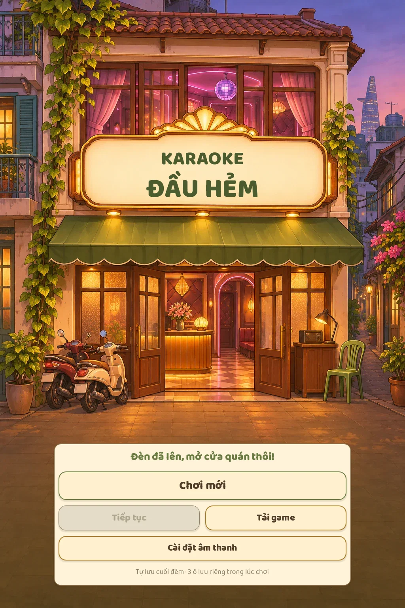
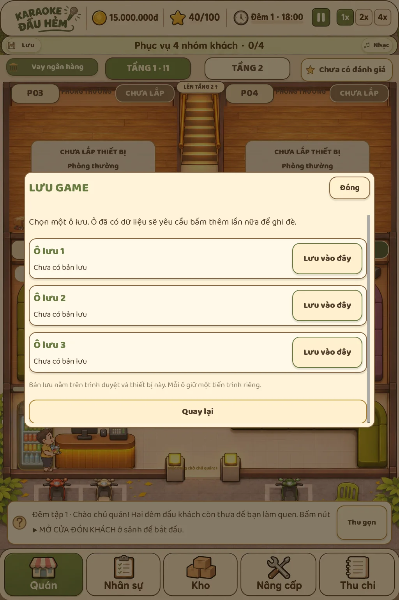

# Giao diện, nhân vật và lưu game

Màn hình vào game dùng mặt tiền quán buổi tối, bảng hiệu chữ Việt rõ nét, Chơi mới, Tiếp tục, Tải game và cài đặt nhạc. Bấm vào game có màn hình tải tài nguyên thực tế.

Ba ô lưu thủ công tách khỏi tự lưu cuối đêm. Có thể lưu giữa ca: giữ đồng hồ, RNG, khách, phòng, kho, hóa đơn, khoản vay và công việc chủ quán/nhân viên đang thực hiện. Ô có dữ liệu cần bấm xác nhận ghi đè. Tiếp tục chọn bản hợp lệ mới nhất. Bản chính lỗi có thể khôi phục từ bản sao lưu; bản cũ trước cập nhật vẫn đọc được. Trên web, tiến trình thuộc trình duyệt/thiết bị hiện tại, có bản sao localStorage để đọc ngay khi tải lại trang.

Nhân sự có sáu diện mạo theo vai trò. Tạp vụ chỉ cầm dụng cụ khi dọn; phục vụ và chủ quán tay không lúc rảnh, đến tủ lạnh lấy khay, mang đến phòng rồi trở lại tay không. Giao món xác nhận theo vị trí thực trong cảnh; đơn bị hủy hoặc đã có người giao không bị tính tiền trùng. Đường đi lên VIP vẫn qua cầu thang.

Các bảng nhân sự, vay, đánh giá, hướng dẫn dùng màu kem/nâu/olive, thẻ thống kê và nút đồng bộ. Nhạc có ba bài nhẹ, điều chỉnh âm lượng, bật/tắt, lựa chọn được lưu riêng. Nguồn và giấy phép trong bảng cài đặt cùng `assets/audio/CREDITS.txt`.

Kiểm chứng:
- `tests/run_tests.gd`: 395 kiểm tra mô phỏng, gồm lưu/tải giữa ca và cùng diễn biến sau khi tải.
- `tests/ui_content.gd`: hướng dẫn, vay, thiết bị, sự kiện, nhân sự, đánh giá, tự lưu và Tiếp tục.
- `tests/ui_fridge.gd`: tủ lạnh → khay → phòng, chống giao trùng, hủy đơn, đường lên VIP, giải mã cả ba bản nhạc.
- `tests/ui_saves.gd`: bấm ô lưu trong lúc đang bưng khay, tải lại đúng trạng thái, giao tiếp một lần, xác nhận ghi đè, chọn bản lưu mới nhất.

Xuất web xong chạy `python3 tools/prepare_web.py` để chép nhạc riêng; trình triển khai phải lấy cả thư mục con `music/`.
