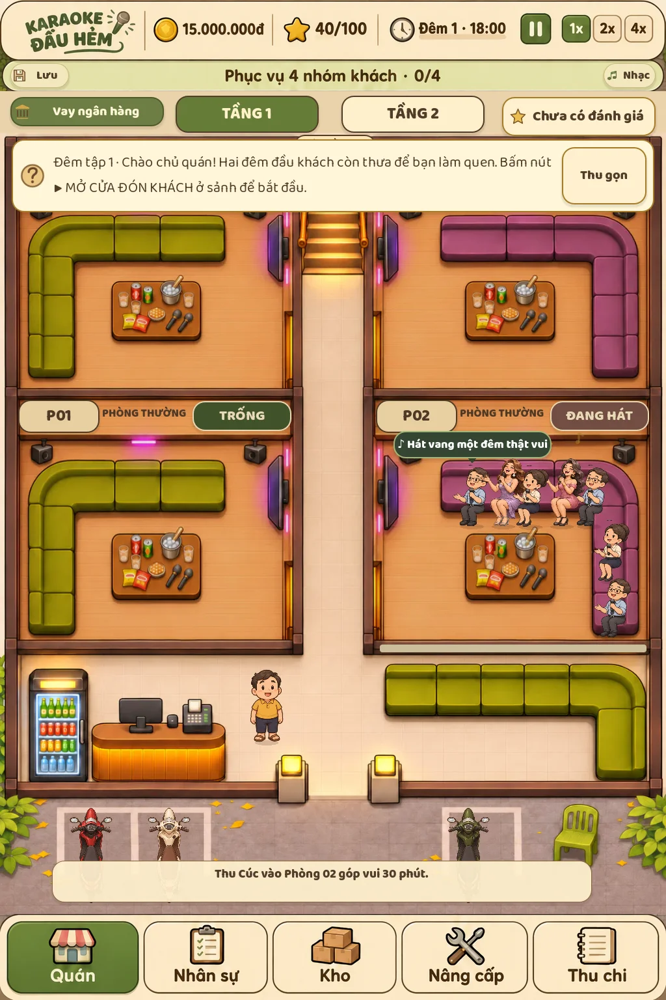
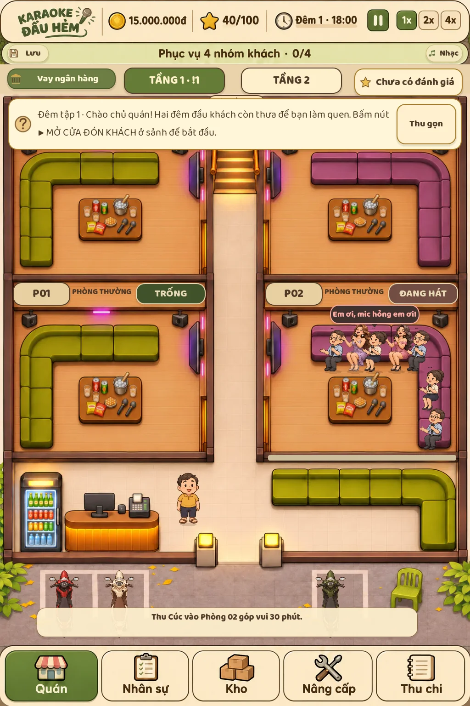
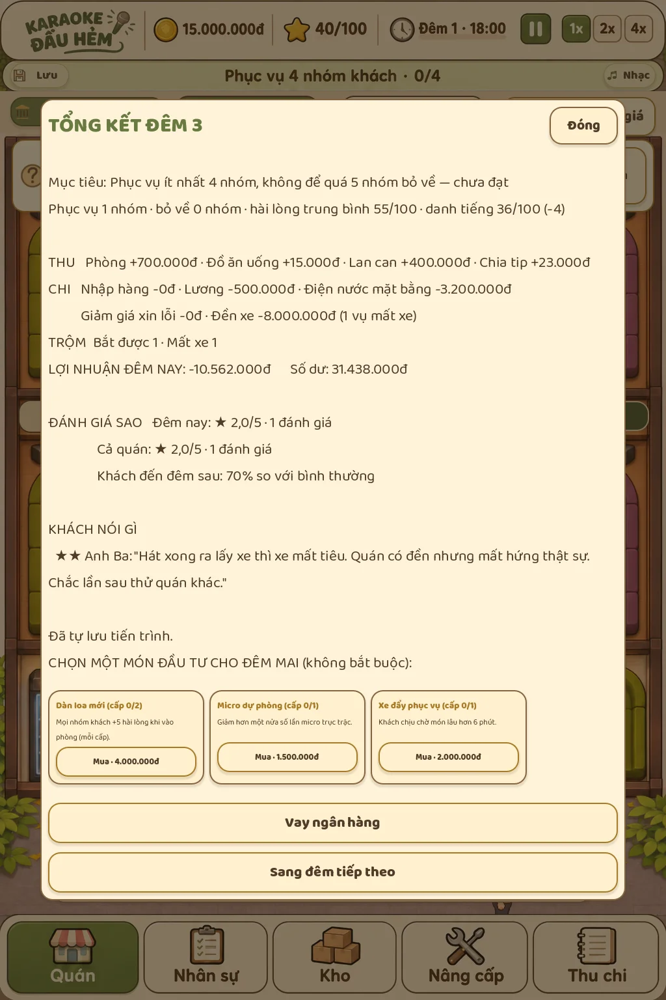

# Sửa vòng ngày và cảm giác quán hát

Nút Sang đêm tiếp theo được ghim ngoài vùng cuộn của bảng tổng kết. Đóng bảng vẫn có nút sang đêm ở sảnh. Chuyển đêm dọn hàng việc, trạng thái nhân vật và khóa modal, về tầng 1 lúc chuẩn bị, tự lưu mốc mới.

Bàn ở cả hai tầng nhỏ hơn khoảng 20%. Năm vị trí khách nằm trên mặt ghế chữ L, không còn trạm ngồi ở khoảng sàn dưới phòng. Người giao lưu ghép sát cạnh khách theo chỉ số ghép cặp. Kích thước nhân vật giữ nguyên.

Bong bóng có đuôi đặt trên đầu người nói. Câu hát trắng trên nền tối; gọi đồ màu vàng, mic hỏng hồng đỏ, nóng màu cam và hát thêm xanh. Yêu cầu nằm trong câu nói tự nhiên, chẳng hạn “Em ơi, mic hỏng em ơi!”. Các câu người giao lưu nhường chỗ khi khách đang nói để tránh chồng nhiều bong bóng trong phòng.

Ván mới không có nhân viên, còn bản lưu vẫn giữ những người đã tuyển. Bảo vệ là thẻ trong cùng bảng nhân viên; không còn mục riêng hay hướng dẫn chi tiết cơ chế bảo vệ.

Ba xe vẽ sẵn đã bỏ khỏi nền. Xe riêng nền trong suốt được tạo theo khách đang có mặt, trừ số xe bị mất. Trộm có bộ hình riêng gồm bốn bước chân, dáng phá khóa, chạy và bị bắt. Ở giao diện thật, bấm đuổi chỉ bắt đầu chạy; phải đến gần trộm trước thời hạn mới bắt được. Không kịp thì mất xe và đền 8 triệu/chiếc. Hướng dẫn chung tránh che khu vực xe.

Kiểm tra: bộ mô phỏng 396 kiểm tra; `tests/ui_experience.gd` kiểm tra người ngồi, màu thoại, xe đến/về/mất, đuổi thật, thẻ tuyển bảo vệ, nút sang ngày luôn hiện và đi qua hai ngày liên tục. `ui_content` xác nhận nội dung, tự lưu và tiếp tục vẫn hoạt động.

