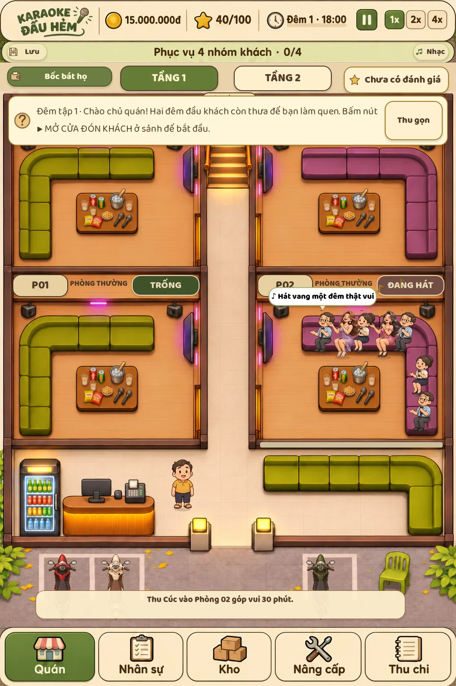
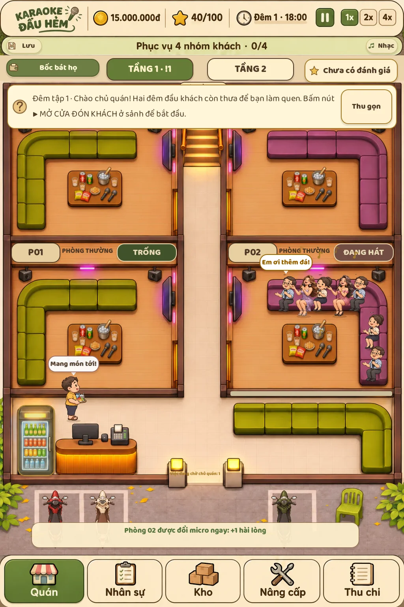
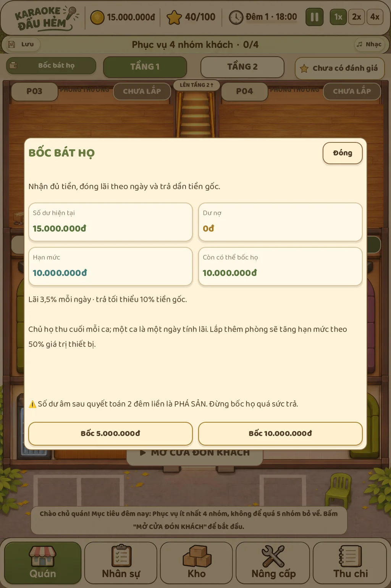
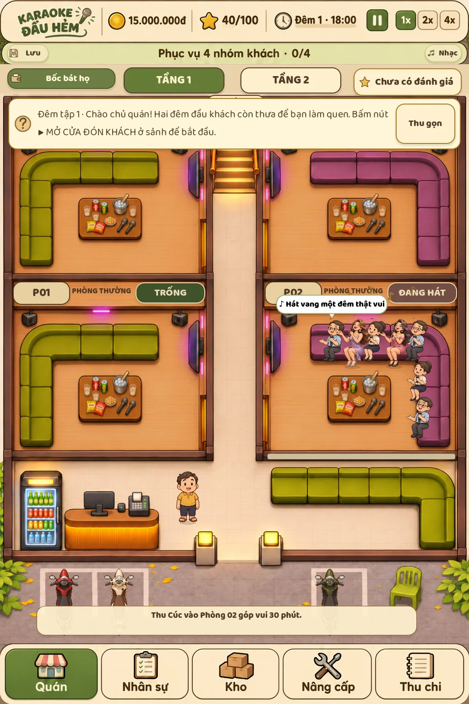
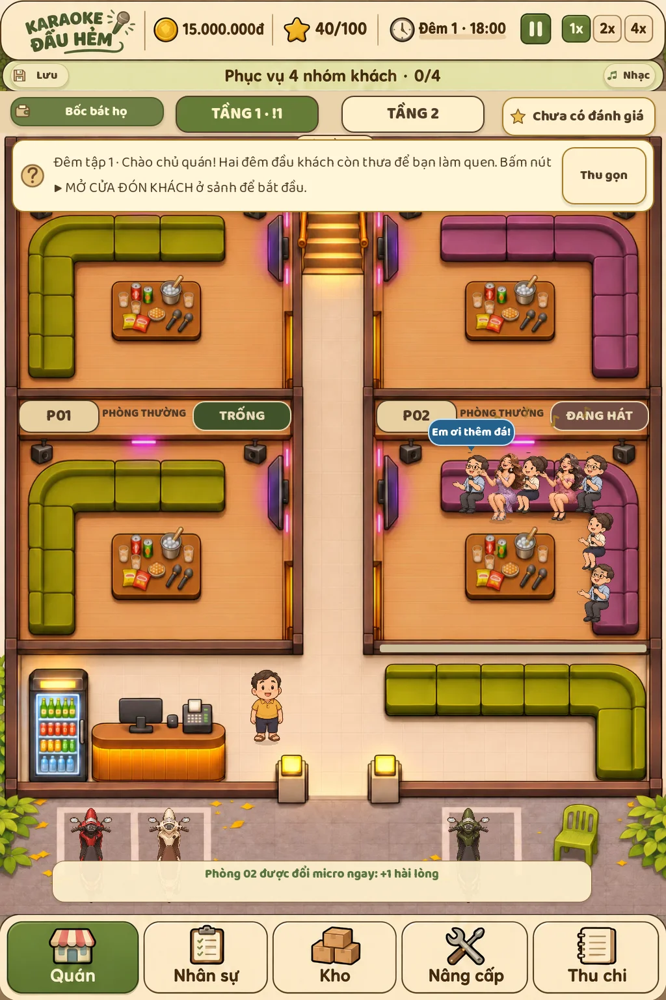
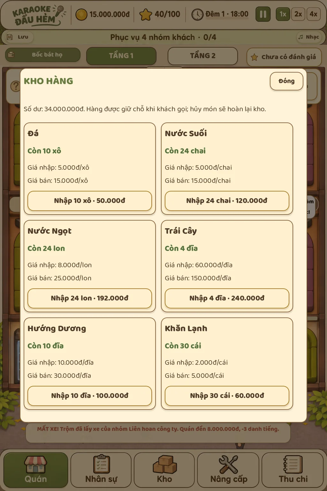
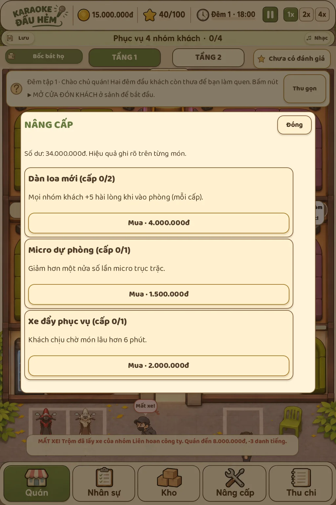
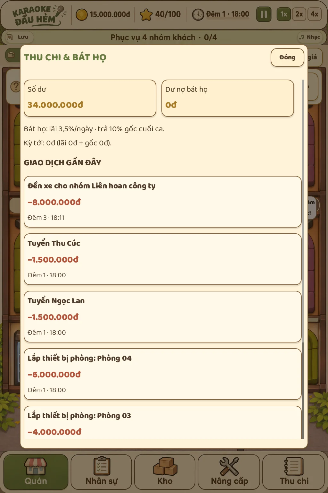

# Thoại, bài hát và bát họ

Thoại thường của khách: nền trắng, chữ đen. Yêu cầu phục vụ dùng nền xanh dương (gọi đồ), đỏ (mic hỏng), cam (nóng) hoặc tím (giao lưu), chữ trắng để phân biệt với thoại thường. Người đang nói được chọn trong đủ năm thành viên của nhóm.

- Câu tao/mày chỉ dành cho nhóm bạn thân và hội trẻ; không dùng chung cho gia đình hoặc công ty.
- Cặp đôi lọc người nói/người đáp theo giới tính cho các câu anh/em; lời ông/con của gia đình lọc cả lứa tuổi.
- Người giao lưu đổi cách gọi bạn, anh/chị, chú/cô theo khách đang phục vụ.
- Câu về việc đi làm hoặc chia tiền không dùng bừa cho nhóm gia đình và khách lớn tuổi.
- Câu hát lọc theo tuổi người cầm mic, sau đó ưu tiên gu nhạc của nhóm.

Bổ sung trích đoạn ngắn của Đừng Làm Trái Tim Anh Đau, Mang Tiền Về Cho Mẹ, Có Chắc Yêu Là Đây, Em Xinh; kho người lớn có Thành Phố Buồn, Đường Tình Đôi Ngả, Đời Tôi Cô Đơn và Lòng Mẹ. Mỗi bài thật chỉ có một trích đoạn ngắn, không chép cả đoạn lời dài. Những câu tự sáng tác trước đây vẫn có trong kho và không gán cho bài thật.

Thoại chọn bài có Lời Ong Bướm, Mỹ Miều và Nếu Một Mai Tôi Bay Lên Trời. Tham khảo bảng iTunes Việt Nam được kiểm tra ngày 14/11/2026: https://itunes.apple.com/vn/rss/topsongs/limit=30/json. Đây là danh mục tham khảo tại thời điểm cập nhật, không phải một bảng xếp hạng tự cập nhật trong game.

Bốc bát họ thay toàn bộ nhãn vay ngân hàng. Trong mô hình game, người chơi nhận đủ tiền bốc; lãi 3,5%/ngày trên gốc còn lại, thu cuối ca cùng 10% gốc. Một ca tương ứng một ngày tính lãi. Mốc chốt ngày được lưu cùng tiến trình, gọi chốt lại cùng ngày không trừ thêm tiền hoặc gốc. Không cộng lãi theo thời gian đóng trình duyệt.

Vị trí ngồi dùng điểm tiếp xúc dưới hông thay cho bàn chân; bù theo tỷ lệ ảnh khách và người giao lưu, giữ tiếp xúc khi nhún hát. Mặt đệm được căn riêng cho từng hàng thường/VIP. Đường đi ở sảnh dùng các vùng chắn của quầy và tủ lạnh, lấy hàng ở phía sau quầy; bản lưu cũ được dựng lại đường đi khi tải.

Ghế dọc đặt điểm tì gần mép trong để chân buông xuống sàn; cặp khách/người giao lưu nằm liền nhau dọc nhánh ghế. Kho dùng thẻ hai cột, nâng cấp dùng thẻ cả hàng; thu chi tách từng giao dịch với số tiền lớn. Chữ nội dung 22–30 thay cho bảng 12–14 trước đây.

